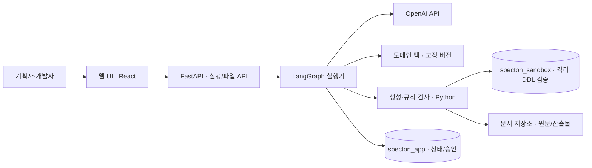
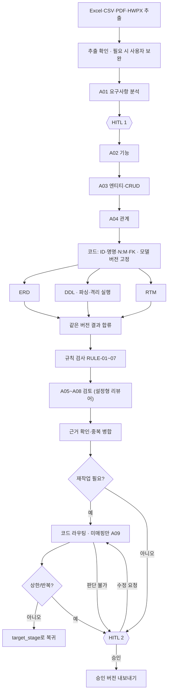
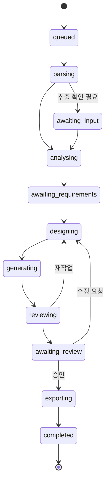

# 아키텍처

> 상태: **초안** (착수 문서 v0.1 기준, 실행기·배포 방식은 회의 결정 전)
> 원본: 상위 기획 폴더 `docs/개발착수_문서/03_시스템_아키텍처.md`, `LLM_기능_설계.md`

## 구성도

- 실행기는 API와 같은 배포 단위로 시작할 수 있다. 다만 API 요청 스레드에서 장시간 작업을 동기로 수행하지 않는다.
- 제안: 영속 run 레코드 + 작업 claim/lease로 실행기를 구동하고, 외부 메시지 큐는 두지 않는다. 프로세스가 죽으면 lease 만료와 체크포인트를 확인해 한 실행자만 재개한다. 확정은 ADR-0012.
- 로컬은 Docker PostgreSQL, 배포는 AWS Docker 컨테이너. 같은 이미지를 쓴다 (ADR-0013).

## 실행 흐름

- A01~A04는 앞 단계 결과를 쓰므로 순차 실행한다.
- ERD·DDL·RTM은 같은 고정 모델을 읽는 코드 작업이라 병렬로 실행한다. DDL 내부의 생성 → 파싱 → 격리 실행은 순서를 지킨다.
- 검토 관점 4개는 같은 버전 문맥으로 병렬 또는 묶음 실행한다 (ADR-0008, [04 에이전트](04-agents.md)).
- 파서·API·생성기 장애는 실행 오류로 분리한다. 설계 재작업 루프에 넣지 않는다.

### 재작업 복귀 단계

| `target_stage` | 복귀 대상 | 다시 실행하는 범위 |
|---|---|---|
| `requirements` | A01 | 요구사항 분석·HITL 1부터 끝까지 |
| `functions` | A02 | 기능 설계부터 끝까지 |
| `data_model` | A03 | 엔티티·CRUD부터 끝까지 (관계 문제도 여기로) |

- `relationships` 단독 복귀 값은 없다. 필요하면 계약 변경으로 검토한다.
- 재작업은 최초 실행 뒤 **최대 3회**. 구조화 출력 재요청(최대 2회)과 별개다.
- 동일 지적 반복·상한 도달·판단 불가면 자동 루프를 멈추고 HITL 2로 넘긴다.

## 상태·버전

- 어느 단계에서든 `failed`, 또는 `cancel_requested` → `cancelled`로 갈 수 있다.
- `failed` 복구는 오류 종류와 마지막 checkpoint를 명시하며 무조건 처음부터 다시 실행하지 않는다.
- 각 단계는 `run_id`, `revision`, `iteration`, 입력 해시를 갖는다.
- 병렬 가지는 별도 결과 필드에 기록한다. 합류는 기대 가지 집합과 같은 revision인지 확인하며, 한 가지의 실패를 빈 결과로 대체하지 않는다.
- 리뷰 결과는 현재 iteration에서 새로 모으고, 과거 지적 지문은 이력에 남긴다.

## 책임 경계

| 대상 | LLM | 코드 | 사용자 |
|---|---|---|---|
| 입력 문서 | 원문 의미 분석 | 추출·출처 보존 | 추출 오류·불명확 조건 확인 |
| 기능 명세서 | 기능 분해·설명·우선순위 근거 | ID·CRUD 연결 검사·템플릿 출력 | 범위·우선순위 확인 |
| ERD | 엔티티·속성·관계 판단 | 명명·N:M 변환·Mermaid 생성 | 업무 모델 검토 |
| DDL | 타입·제약 후보 판단 | FK 파생·SQL 생성·pglast·격리 DB 실행 | 승인된 설계 확인 |
| RTM | 근거 요구사항 연결 제안 | 현재 ID로 조인·미연결 표시 | 추적 누락 검토 |
| 설계 검토 | 모순·누락 후보 제시 | 규칙 검사·근거 확인·중복 병합 | 미정 정책·잔여 쟁점 결정 |
| 실행 제어 | 미매핑 경우에만 복귀 단계 제안 | 상태·재시도·병렬 합류·버전·한도 | 재개·수정·승인·보류 |

- LLM은 Mermaid나 SQL 전문을 쓰지 않는다. ID도 만들지 않는다.
- Pydantic은 형식·열거값·참조 후보만 검증한다. 의미의 정확성은 검토·평가로 따로 본다.
- pglast·격리 DB 성공은 DDL의 실행 가능성일 뿐, 업무 요구 충족을 증명하지 않는다.
- UI는 API만 호출한다.

## 코드 구조

| 폴더 | 책임 |
|---|---|
| `specton/contracts/` | 단계 간 데이터 계약 (상태·LLM 입출력·Finding) |
| `specton/ingest/` | Excel·CSV·PDF·HWPX 추출, 원문 위치 보존 |
| `specton/packs/` | 도메인 팩 로더·생성기 |
| `specton/llm/` | 공통 LLM client·재요청·프롬프트 버전 |
| `specton/nodes/` | 에이전트 노드 A01~A09 (얇은 어댑터) |
| `specton/codegen/` | ID·명명·N:M·FK, Mermaid·DDL·RTM 생성 (LLM import 금지) |
| `specton/review/` | 규칙 검사·설정형 리뷰어·근거 병합 |
| `specton/validate/` | DDL 파싱·격리 DB 실행 (LLM import 금지) |
| `specton/persistence/` | 플랫폼 저장·checkpointer |
| `specton/export/` | 중간 Markdown, 최종 PDF·SQL·Excel/CSV |
| `specton/api/` | FastAPI |
| `specton/graph.py` | 전체 그래프 연결 (통합 담당 R1만 수정) |

## 품질 시나리오

| 상황 | 기대 동작 |
|---|---|
| LLM 일시 실패·거절 | 원인 분리, 제한된 재시도, 실패 상태와 다음 행동 안내 |
| HITL 대기 중 서버 재시작 | 원문·revision·interrupt를 복구하고 같은 실행 재개 |
| 승인된 모델 변경 | 새 revision, 기존 승인 무효화, 후속 산출물 재생성 |
| 같은 resume 동시 요청 | revision·interrupt 비교로 1건만 적용, 나머지 409 |
| 문서 안의 실행 지시 | 입력 데이터로만 처리, 프롬프트·SQL 권한을 주지 않음 |
