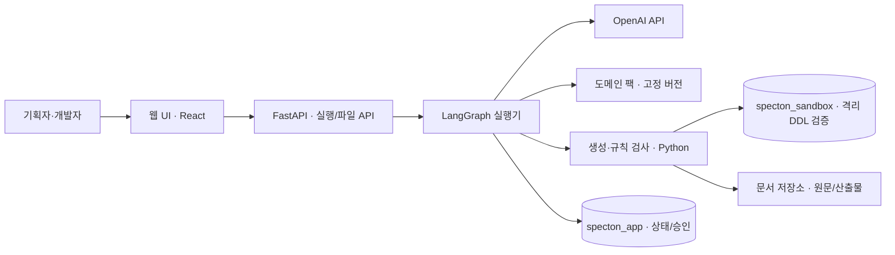
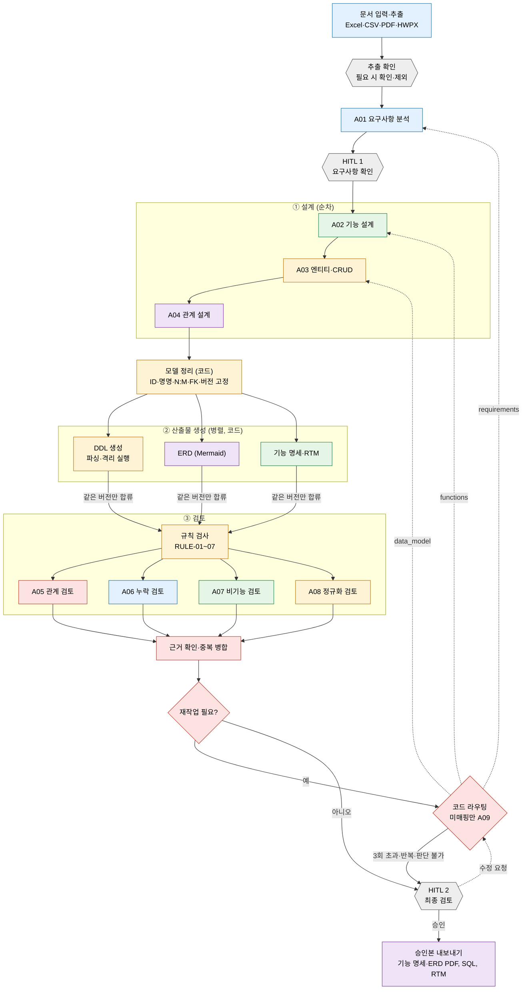
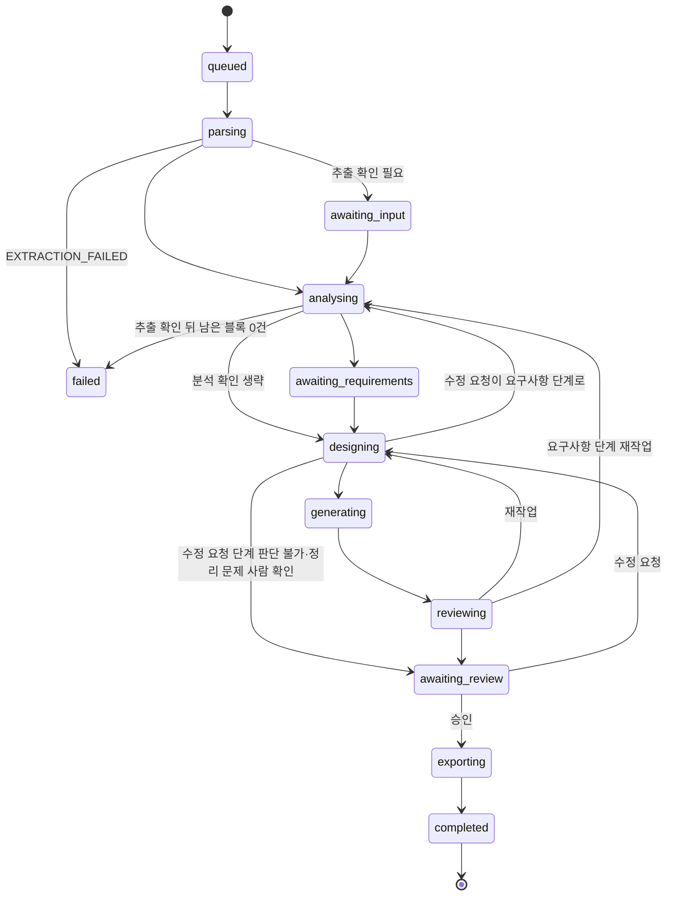

# 아키텍처

> 상태: **초안** (실행기·배포 방식은 회의 결정 전)

## 구성도

- 실행기는 API와 같은 배포 단위로 시작할 수 있다. 다만 API 요청 스레드에서 장시간 작업을 동기로 수행하지 않는다.
- 영속 run 레코드 + 작업 lease로 실행기를 구동하고, 외부 메시지 큐는 두지 않는다. 프로세스가 죽으면 lease 만료와 체크포인트를 확인해 한 실행자만 재개한다. 실행 수, lease 시간, 저장 순서, 취소 규칙은 ADR-0012.
- 로컬은 Docker PostgreSQL, 배포는 AWS Docker 컨테이너. 같은 이미지를 쓴다 (ADR-0013).

## 실행 흐름

색은 담당 역할, 회색 육각형은 사람(HITL) 단계, 점선은 재작업 경로다.

| 색 | 역할 | 흐름에서 맡는 단계 | 흐름 밖에서 상시 맡는 것 |
|---|---|---|---|
| 🟥 | R1 실행 제어·통합 | A05 관계 검토, 병합·재작업 판단·라우팅(A09) | 그래프 연결·상태·멈춤/재개 |
| 🟦 | R2 입력·분석·평가 | 문서 입력·추출, A01 분석, A06 누락 검토 | 평가 데이터·채점 |
| 🟩 | R3 기능·API·저장 | A02 기능, RTM, A07 비기능 검토 | API·DB 저장·데이터 계약, 기능 명세 템플릿 |
| 🟨 | R4 데이터 모델·검증 | A03 엔티티, 모델 정리, DDL, 규칙 검사, A08 정규화 검토 | 격리 DB 검증 |
| 🟪 | R5 관계·시각화·웹 | A04 관계, ERD, PDF 내보내기 | 웹 화면·AWS 배포 |

역할 배정은 제안 (ADR-0001). 검토 관점 A05~A08은 설정형 리뷰어 노드 1종으로 구현한다 (ADR-0008).

- A01~A04는 앞 단계 결과를 쓰므로 순차 실행한다.
- ERD·DDL·RTM은 같은 고정 모델을 읽는 코드 작업이라 병렬로 실행한다. DDL 내부의 생성 → 파싱 → 격리 실행은 순서를 지킨다.
- 검토 관점 4개는 같은 버전 문맥으로 병렬 또는 묶음 실행한다 (ADR-0008, [04 에이전트](04-agents.md)).
- 파서·API·생성기 장애는 실행 오류로 분리한다. 설계 재작업 루프에 넣지 않는다.

### 모델 정리 실패 경로 (#17·#15)

- `normalize` 노드가 `normalization_failed=true`, `rule_findings`를 반환하면 DDL·ERD·RTM 생성과 LLM 검토를 건너뛴다. #15에서 변환한 현재 규칙 지적을 설계 상태에 담아 기존 재작업 판단으로 보낸다. 실행하지 않은 리뷰 관점은 실패한 리뷰로 표시하지 않는다.
- `requires_manual_review=true`이면 자동 재작업 가능 지적이 함께 있어도 A09를 호출하지 않고 바로 HITL 2로 간다. 사유는 `manual_review`다. 자동 수정 가능한 실패는 기존 `target_stage`·반복 지적·3회 상한 규칙을 따른다.
- 정리 실패에는 최소 한 건의 `critical` 규칙 지적이 필요하다. 지적이 없는 실패 반환은 실행 오류로 처리하며, 정리 함수에서 발생한 예외도 실행 오류로 전파한다. 저장된 차단 지적은 resume API의 승인을 막고, 그래프 직접 재개에서도 정리 실패의 내보내기를 막는다.
- 재작업을 시작하면 이전 정리 실패 표시·사람 조치 표시·규칙 지적을 비워 새 반복에서 다시 판단한다. 사람의 명시적인 수정 요청은 자동 재작업 횟수로 세지 않는다.

`specton/normalization_node.py`의 `normalization_node(map_failure, root=...)`는 실제 `normalize_from_state`를 호출한다. 호출자는 `settings.pack_root`를 넘기고, 명명 규칙과 자기참조 접두어는 그 경로의 YAML에서 읽는다 (#148·#151). 성공 모델은 #143의 `DesignState.normalized`에 담고, 실행기가 기존 `save_model` 경로로 저장·해시한다. 재작업은 설계 노드를 다시 실행하기 전에 이 값을 비운다.

실패의 `Problem.code`·`decision`·`pending`은 변환 콜백으로 그대로 넘긴다. `FK_COLUMN_CONFLICT`는 D4와 D13의 처리 경로가 다르므로 메시지로 구분하지 않는다. 콜백 결과는 규칙 지적(`findings`)과 사람 조치 여부(`requires_manual_review`)이며, R4의 실제 #15 반환형을 감싸는 R1 내부 연결 형식이다. 팩 불일치·출력 추적 오류와 잘못된 명명 설정은 실행 오류로 남긴다.

API의 `create_graph`는 실제 정리 노드와 #15 실패 변환기를 등록한다. 둘 다 `settings.pack_root`를 사용하며 규칙 심각도는 그래프를 만들 때 공통 팩에서 읽는다. #168의 `unsupported_relationship` 구분에 따라 설계 규칙 위반(D8)은 자동 재작업하고, 자기참조 N:M의 지원 부족(D4)은 바로 사람 확인으로 보낸다. 실제 API 경로에서 성공 모델 저장·재작업·재시작·승인 차단을 검증한다.

ERD 가지는 `specton.erd_node`를 등록한다. 저장된 `DesignState.normalized`와 같은 설계의 관계로 상세 Mermaid 원문을 만들고, UTF-8 바이트를 `write_artifact()`로 초안 `.mmd` 파일에 저장한다. 노드는 파일·모델 해시와 현재 revision을 담은 `GeneratedArtifact`만 기존 채널로 반환하며, 실행기가 모델·진행·산출물·이벤트를 같은 트랜잭션으로 게시한다. 정리 실패 시 ERD도 건너뛰며, 생성·저장 오류는 실행 오류로 전달한다. 후속 전체 규칙의 실제 노드 등록은 후속 범위다.

기존 `rtm` 가지에는 `specton.document_node`를 등록한다. #213 기능 명세 Markdown과 #215
RTM Excel·CSV 생성기를 순서대로 호출하고 세 파일을 같은 고정 모델·revision의 초안으로
반환한다. 성공한 정리 결과와 실행의 팩·버전이 일치해야 하며, 정리 실패 시 이 가지도 건너뛴다.
체크포인트 노드 구성은 유지한다. 노드는 DB에 쓰지 않고, 실행기가 기존 채널의
`GeneratedArtifact`를 모델·진행·이벤트와 같은 트랜잭션으로 게시한다. 문서 생성 예외에는
일부 문서의 성공 기록을 만들지 않으며, 다른 가지에서 완료한 SQL·검증 기록의 복구는 유지한다.
RTM의 원문 분할·제외·원문 없음 행은 저장된 설계에서 그대로 계산한다. 보류·재시작에는
체크포인트의 파일을 재사용하고 설계 수정에는 새 revision 파일을 만든다.
이 연결 전 최종 검토에 도달한 실행에는 새 문서를 소급 생성하지 않는다.
기능 명세 PDF는 후속 범위다.

기존 `wait_review` 노드에는 `specton.manifest_node`를 연결한다. 리뷰·라우팅 뒤의 최종 버전 정보를
포함해 현재 revision 산출물의 manifest JSON을 비공개 승인 후보로 준비한다. 자신의 해시는
목록에서 제외한다. 새 체크포인트 노드는 추가하지 않으며 이미 최종 검토에 도달한 실행을
승인할 때 문서를 소급 만들지 않는다. 실행기가 다른 산출물과 같은 트랜잭션으로 후보를 게시하고,
승인 근거에 JSON 해시를 함께 기록한다. 내보내기는 모델·파일 목록이 후보 내용과 같은지 확인한
뒤 동일 바이트를 승격한다. 승인 전 JSON 다운로드는 차단하며, 보류·재시작은 같은 후보를 쓴다.

`SPECTON_ENABLE_ERD_PDF=true`이면 같은 ERD 가지에 `specton.pdf_adapter`를 연결한다.
실행에 기록된 팩·버전과 `settings.pack_root`의 팩을 대조하고, 그 팩의 업무 영역과 #209 엔진으로
표지·전체 개요·영역별 상세도·테이블 정의서 PDF를 만든다. 승인 전에 최종 문서용 바이트를
한 번 준비하되 `ArtifactRef.approved=false`로 저장하여 다운로드를 차단한다. 렌더러의
`draft=false`는 문서 표식만 정하고 사용자 승인 여부를 바꾸지 않는다. HITL 2에서 다른
산출물과 함께 이 PDF 해시를 승인 근거에 기록하고, 내보내기는 재렌더링 없이 같은 바이트를
승인본으로 승격한다. 재시작은 저장된 후보를 재사용하며, 설계 수정은 새 revision의 후보를 만든다.
6pt 경고는 기존 상태 이벤트에 남기고, 외부 리소스 차단·잘못된 PDF·엔진 오류는 실행 실패로
처리한다. PDF를 켠 상태에서 생성에 실패해도 PDF 없이 성공한 것으로 우회하지 않는다.

PDF 설정의 기본값은 비활성이다. #209 인계와 #25 실행 이미지의 Pango·Noto CJK 폰트·
mermaid-cli(안의 mermaid 11.17.2, ADR-0004)·Chromium 준비 뒤 활성화한다. CLI 명령은
`SPECTON_MERMAID_CLI_COMMAND`의 JSON 배열, 브라우저 설정은
`SPECTON_MERMAID_PUPPETEER_CONFIG`의 JSON 파일 경로로 전달한다.

### SQL 검증 시도의 체크포인트 (#17·#167)

실행 문맥은 검증기 밖에서 붙인다. `specton.validation_attempts.run_validation_attempt()`는
검증 호출마다 새 UUID `validation_id`를 부여하고, `run_id`·`GeneratedArtifact`·공용
`SqlValidation`을 한 시도로 반환한다. 검증기가 반환한 직후 UTC `validated_at`을 한 번 읽어
결과와 함께 보존한다. 검증 전에 실행·revision·모델 해시·SQL 바이트 해시를
확인하고, 검증 후에도 결과의 SQL 해시가 같은지 확인한다. `error`·`failed`·`unverified`도
원래 결과를 유지하며, 예상하지 않은 예외에는 가짜 검증 결과를 만들지 않는다.

생성 노드는 산출물 메타데이터와 함께 `GraphState.validation_attempts`에 시도를 반환한다.
체크포인트의 기존 시도를 재저장할 때는 ID·검증 시각을 그대로 사용하고 검증을 다시 호출하지 않는다.
같은 ID·같은 결과는 중복 없이 합치고, 같은 ID에 다른 결과·산출물 문맥·검증 시각이 오면 거절한다.
검증 시각은 시간대가 있는 `datetime`으로 복원하며, 누락된 시각을 재저장 시점으로 추정하지 않는다.
실행기는 산출물을 게시한 뒤 `publish_validation_attempts()`에서 R3 `save_validation`에
ID·검증 시각·모델 해시·공용 결과를 그대로 넘긴다. 진행·모델·산출물·이벤트·검증 기록은 하나의
앱 DB 트랜잭션으로 커밋되며, 검증 기록 저장이 실패하면 앞선 게시도 롤백된다. 실행기는
`updates`의 노드 안내를 모으고 뒤따르는 `checkpoints` 이벤트의 지정된 체크포인트를 읽는다.
확정 전 최신 상태를 읽어 SQL 교체 전 시도의 게시가 늦어지지 않도록 한다. 시각이 같은
시도는 최초 저장 순서로 최신 기록을 고르므로 체크포인트의 삽입 순서를 유지하고 UUID로
정렬하지 않는다. 이미 저장된 과거 시도는 SQL 재생성 뒤에도 멱등하게 재전달할 수 있지만,
현재 산출물·모델 해시와 다른 미저장 시도를 처음 게시하려 하면 거절한다.
같은 SQL·버전으로 새 검증을 호출하거나 모델·revision이 바뀌면 새 시도로 남긴다. 이 정보는
설계 모델·모델 해시나 공개 API에 넣지 않는다. 기존 체크포인트에는 결과를 소급 생성하지 않는다.

노드 경계에서 취소·lease 상실을 확인하면 해당 노드의 산출물과 검증 결과를 게시하지 않는다.
체크포인트가 앱 저장보다 앞선 채 중단되면 기존 재개 경로가 같은 시도를 다시 저장하며, 검증을
재호출하거나 ID·시각·최신 순서를 바꾸지 않는다. 기존 대기·진행 저장 경로에만 연결하며, 현재
API 기본 그래프는 `ddl_node()`로 실제 DDL 생성과 격리 DB 다섯 단계 검증을 연결한다.
`passed`일 때 후속 규칙·리뷰로 진행한다. `failed`·`unverified`이면 후속 리뷰를 실행하지 않고
사람 확인으로 보내며, A09·자동 설계 재작업과 승인·내보내기는 건너뛴다. `failed`이면
`ddl_node()`가 검증 문제마다 RULE-07 지적을 만든다. 대상은 문제가 난 SQL 문장의 원래 설계
객체(CREATE TABLE → 엔티티, ALTER TABLE FK → 관계)이고, 문장 번호가 없는 파싱 실패는 모든
객체를 대상으로 둔다. 지문이 같은 문제는 지적 하나로 합치고 근거를 모두 남긴다(04 「지적 확정
절차」). `unverified`에는 SQL 결함이 없으므로 지적을 만들지 않는다. 승인 차단은
SQL 검증 상태와 R3 승인 검사로 보장한다.

`error`이면 실행기는 동일 SQL·안전한 검증 기록의 커밋 뒤 실행 실패를 기록한다. DB 접속
정보나 내부 예외 원문을 실행 오류 응답에 넣지 않는다. SQL 생성 전 예외에는 가짜 SQL·검증
행을 만들지 않는다. 병렬 생성의 다른 가지가 예외로 끝나 step을 확정하지 못해도, 성공한
DDL 노드의 pending writes에 현재 revision·SQL·모델과 맞는 검증 시도가 있으면 해당 SQL과
검증 이력을 먼저 게시한다. 실패한 가지의 결과를 만들지 않으며, 이미 저장한 시도는 다시
게시하지 않는다. 이 복구 게시에도 취소·lease 검사를 적용하고 기존 트랜잭션을 사용한다.
복구 게시 직후 중단돼도 재개 시 검증 ID·시각을 그대로 사용한다.
실제 생성·검증·저장 연결에 맞춰 SQL 승인 검사 기본값을 켠다
(`SPECTON_REQUIRE_SQL_VALIDATION=true`). 기존 승인에 검증 근거를 소급 생성하지 않는다.

API의 `export_node()`는 현재 revision의 승인한 SQL·Mermaid·PDF 후보·기능 명세 Markdown·RTM·manifest 바이트를 그대로 승인본으로
인계한다. 실행기는 `approval_basis.artifact_hash`와 비교해 승인 이후 변경된 바이트나
승인 근거에 없는 새 산출물의 게시를 거절한다.

### 재작업 복귀 단계

| `target_stage` | 복귀 대상 | 다시 실행하는 범위 |
|---|---|---|
| `requirements` | A01 | 요구사항 분석·HITL 1부터 끝까지 |
| `functions` | A02 | 기능 설계부터 끝까지 |
| `data_model` | A03 | 엔티티·CRUD부터 끝까지 (관계 문제도 여기로) |

- `relationships` 단독 복귀 값은 없다. 필요하면 계약 변경으로 검토한다.
- 재작업은 최초 실행 뒤 **최대 3회**. 구조화 출력 재요청(최대 2회)과 별개다.
- 동일 지적 반복·상한 도달·판단 불가면 자동 루프를 멈추고 HITL 2로 넘긴다.

## 상태·버전

- 추출 확인(UI-02)과 분석 확인(UI-03)은 확인할 것이 있을 때만 멈춘다 (ADR-0015). 모든 원문이 `pass`면 `parsing → analysing`, 분석 확인 조건이 없으면 `analysing → designing`으로 가고 UI-04에 「분석 확인 생략」을 표시한다.
- 파일 단위로 읽지 못하거나(손상·빈 양식 등) 제외 뒤 남은 블록이 0건이면 `EXTRACTION_FAILED`로 `failed`가 된다.
- HITL 2 수정 요청은 API가 먼저 `designing`으로 바꾸고, A09가 요구사항 단계로 보내면 `designing → analysing`이 된다. A09가 복귀 단계를 정하지 못하면 새 확인 요청으로 다시 최종 검토를 묻는다 (`designing → awaiting_review`).
- 어느 단계에서든 `failed`, 또는 `cancel_requested` → `cancelled`로 갈 수 있다. `queued`와 사람 확인 대기 중에는 바로 `cancelled`로 간다 (ADR-0012).
- `failed` 복구는 오류 종류와 마지막 checkpoint를 명시하며 무조건 처음부터 다시 실행하지 않는다.
- 각 단계는 `run_id`, `revision`, `iteration`, 입력 해시를 갖는다.
- 병렬 가지는 별도 결과 필드에 기록한다. 합류는 기대 가지 집합과 같은 revision인지 확인하며, 한 가지의 실패를 빈 결과로 대체하지 않는다.
- 리뷰 결과는 현재 iteration에서 새로 모으고, 과거 지적 지문은 이력에 남긴다.

## 책임 경계

| 대상 | LLM | 코드 | 사용자 |
|---|---|---|---|
| 입력 문서 | 원문 의미 분석 | 추출·출처 보존 | 추출 오류·불명확 조건 확인 |
| 기능 명세서 | 기능 분해·설명·우선순위 근거 | ID·CRUD 연결 검사·템플릿 출력 | 범위·우선순위 확인 |
| ERD | 엔티티·속성·관계 판단 | 명명·N:M 변환·Mermaid 생성 | 업무 모델 검토 |
| DDL | 타입·제약 후보 판단 | FK 파생·SQL 생성·pglast·격리 DB 실행 | 승인된 설계 확인 |
| RTM | 근거 요구사항 연결 제안 | 현재 ID로 조인·미연결 표시 | 추적 누락 검토 |
| 설계 검토 | 모순·누락 후보 제시 | 규칙 검사·근거 확인·중복 병합 | 미정 정책·잔여 쟁점 결정 |
| 실행 제어 | 미매핑 경우에만 복귀 단계 제안 | 상태·재시도·병렬 합류·버전·한도 | 재개·수정·승인·보류 |

- LLM은 Mermaid나 SQL 전문을 쓰지 않는다. ID도 만들지 않는다.
- Pydantic은 형식·열거값·참조 후보만 검증한다. 의미의 정확성은 검토·평가로 따로 본다.
- pglast·격리 DB 성공은 DDL의 실행 가능성일 뿐, 업무 요구 충족을 증명하지 않는다.
- UI는 API만 호출한다.

## 코드 구조

| 폴더 | 책임 |
|---|---|
| `specton/contracts/` | 단계 간 데이터 계약 (상태·LLM 입출력·Finding) |
| `specton/ingest/` | Excel·CSV·PDF·HWPX 추출, 원문 위치 보존 |
| `specton/packs/` | 도메인 팩 로더·생성기 |
| `specton/llm/` | 공통 LLM client·재요청·프롬프트 버전 |
| `specton/nodes/` | 에이전트 노드 A01~A09 (얇은 어댑터) |
| `specton/codegen/` | ID·명명·N:M·FK, Mermaid·DDL·RTM 생성 (LLM import 금지) |
| `specton/ids.py` | 내부 ID 계산 `stable_id` (A03 엔티티·속성 ID와 모델 정리 파생 ID가 함께 사용, 다른 specton 모듈 import 없음) |
| `specton/review/` | 규칙 검사·설정형 리뷰어·근거 병합 |
| `specton/validate/` | DDL 파싱·격리 DB 실행 (LLM import 금지) |
| `specton/persistence/` | 플랫폼 저장·checkpointer |
| `specton/export/` | 중간 Markdown, 최종 PDF·SQL·Excel/CSV |
| `specton/api/` | FastAPI |
| `specton/graph.py` | 전체 그래프 연결 (통합 담당 R1만 수정) |
| `specton/agent_nodes.py` | 에이전트 노드를 그래프 노드로 연결, 팩·프롬프트·모델 버전 기록 (통합 담당 R1만 수정) |
| `specton/parse_node.py` | 업로드 문서를 `ingest/` 파서로 읽는 parse 노드, 파일 단위 실패는 `EXTRACTION_FAILED` (통합 담당 R1만 수정) |

## 품질 시나리오

| 상황 | 기대 동작 |
|---|---|
| LLM 일시 실패·거절 | 원인 분리, 제한된 재시도, 실패 상태와 다음 행동 안내 |
| HITL 대기 중 서버 재시작 | 원문·revision·interrupt를 복구하고 같은 실행 재개 |
| 승인된 모델 변경 | 새 revision, 기존 승인 무효화, 후속 산출물 재생성 |
| 같은 resume 동시 요청 | revision·interrupt 비교로 1건만 적용, 나머지 409 |
| 문서 안의 실행 지시 | 입력 데이터로만 처리, 프롬프트·SQL 권한을 주지 않음 |
