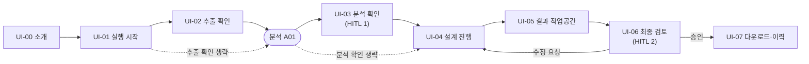

# 화면·사용자 흐름

> 상태: **초안** (화면 수·라이브러리는 회의 결정 전)

## 사용자 작업 흐름

UI-02·UI-03은 확인할 것이 있을 때만 멈춘다. 점선은 확인할 것이 없어 그 화면을 건너뛰는 경로다 (ADR-0015, docs/03 상태도의 `parsing → analysing`·`analysing → designing`).

## 화면 목록

| 화면 | 내용 | 사용자 행동 | 상태·실패 처리 |
|---|---|---|---|
| UI-00 소개 | 팀·프로젝트 소개, 파이프라인 순서의 역할 | 실행 시작으로 이동 | API를 부르지 않는다 |
| UI-01 실행 시작 | 파일 업로드, 팩 선택, 지원 형식·한도 안내, 진행 중·최근 실행 목록 | 업로드·실행·이전 실행 열기 | 파일 오류는 해당 항목에 표시, 중복 클릭 방지. 이전 실행은 이 브라우저 세션의 실행만 보이고(ADR-0011), 불러오지 못해도 업로드는 그대로 쓴다 |
| UI-02 추출 확인 | 원문 위치와 추출 블록 대조, 판정 이유(`notice`) | `review`는 확인 또는 제외(사유 필수), `fail`은 제외만(사유 선택), 전체 중단 | 확인할 블록(`review`·`fail`)이 있을 때만 멈춘다(ADR-0015). 제외하지 않은 `fail`이 남으면 확인 버튼 비활성. 제외하는 원문이 다른 원문의 관련 요구사항이면 경고. 원문 문장이 없는 행은 「원문 없음」으로 표시. 건너뛴 시트는 정보 한 줄 |
| UI-03 분석 확인 | 원문 ID·분류·분할·질문 | 유지·수정·분할 답변 | 품질 경고, 답이 필요한 질문, 분할(같은 원문에서 요구사항 2건 이상)이 있을 때만 멈춘다(ADR-0015). 선택한 수정·분할의 형식 오류와 오래된 revision 안내. 질문 답변은 선택 사항이며, 비워 두었다고 진행을 막지 않음 |
| UI-04 설계 진행 | 단계·병렬 가지·진행 상태 | 조회·취소 | UI-03을 건너뛰었으면 「분석 확인 생략(확인할 항목 없음)」 표시. SSE 재연결, 호출 실패·한도 초과 안내 |
| UI-05 결과 작업공간 | 기능·ERD·DDL·RTM·검토 탭 | 버전 선택·확대·지적 위치 이동 | 미완성 가지는 미완성으로 표시 |
| UI-06 최종 검토 | 현재 revision·지적·근거·제안·설계·SQL 검증 상태·불완전 검토 안내 | 승인·수정 요청·보류 | critical 차단·최신 SQL 필수 조건은 서버가 검사. 보고서 파일은 생성하지 않음 |
| UI-07 다운로드·이력 | 형식별 다운로드·승인 상태 | 파일 선택 | 현재 생성하지 않는 검토 보고서의 빈 행은 숨김. 이전 실행은 새 작업 화면과 `/history`에서 다시 연다. 승인 후 검토 내용은 결과 작업공간의 「검토」 탭에서 revision별 조회 |
| AI Workspace | 실행 단계 그래프, ERD 캔버스, 문서 추적(원문→요구사항→기능→엔티티→관계→지적), 검증 결과·지적 | 단계·엔티티·항목·지적 선택, 확대·이동, revision 선택 | 조회만 한다(승인·수정·원문 편집 없음). 연결은 서버가 준 값으로만 긋고 추정하지 않는다(TC-F12). 제외·확인(원문 없음)은 미연결로 세지 않는다. 상태는 색과 함께 아이콘·글자로 보인다. 기존 UI-02~07 흐름은 바꾸지 않는다(#281) |

### 화면 주소

| 주소 | 화면 |
|---|---|
| `/` | UI-01 새 작업·업로드, 그 아래에 지금 진행 중 작업 표시 |
| `/start` | `/`로 이동하는 이전 주소 |
| `/about` | UI-00 소개·서비스 안내 |
| `/history` | 내 실행 목록·검색 (최근 100건, 현재 세션 소유 실행) |
| `/?run=<id>` | 실행 하나의 화면. UI-02~07 중 무엇을 보일지는 실행 상태(`GET /runs/{id}`)로 정한다. 새로고침해도 같은 실행으로 돌아온다 (TC-F19) |
| `/workspace?run=<id>` | AI Workspace. 사이드바의 「AI Workspace」에서 연다 |

AI Workspace에서 단계를 고르면 선택 설계안의 서버 시각·AI 사용량(토큰)·재요청·소요 시간과
중간 결과를 조회한다(#289). 화면에는 이벤트 번호·호출 모델명·실행 ID를 표시하지 않으며 내부 기록은 유지한다. 노드 이벤트가 있으면 서버 기록을 우선하고, 옛 실행의 단계 묶음 추정과
구분한다. 과거 revision에 노드 기록이 없으면 현재 노드 상태로 메우지 않는다. 재작업 횟수는 선택
revision 기준이다. 정리 실패 지적은 일반 RULE-02 미연결 지적과 구분하며, 실행하지 않은 검토는
지적 0건만으로 통과 처리하지 않는다. DDL은 SQL 앞부분(최대 4,000자)과 검증 상태·시각을 보이고,
다운로드는 기존 소유자·revision·승인 검사 API를 그대로 사용한다. 프롬프트·원응답·내부 경로는 보이지 않는다.

`/runs`로 시작하는 주소는 API용이라 화면 주소로 쓰지 않는다.

### MVP 축소안 (제안, ADR-0002)

| 화면 | 포함하는 기존 화면 |
|---|---|
| 업로드 | UI-01 |
| 확인·승인 | UI-02, UI-03, UI-06 |
| 결과 보기 | UI-04, UI-05, UI-07 |

### 사용자 화면 문구 (#341)

화면 표시명은 파일 올리기 → 원문 확인 → 요구사항 확인 → 설계 중 → 결과 보기 → 최종 승인 → 내려받기로 통일한다.
본문의 UI-01~07 및 API 상태 값은 기존 식별자를 유지한다. 첫 화면 제목은 이전 작업 유무와 관계없이
「어떤 요구사항을 설계할까요?」이며 기존 작업 카드는 유지한다. AI Workspace는 「AI 작업 과정」으로 안내한다.
규칙 코드는 쉬운 이름으로 표시하고 검토 표의 툴팁에서 원래 코드를 확인한다. 실행 ID 복사 버튼은 제거한다.
요구사항 파일은 실제 생성된 경우에만 다운로드 행을 표시한다. 승인·수정·보류와 접근 제어는 변경하지 않는다.
파일 이름이 저장되지 않은 이유를 다른 브라우저 사용으로 단정하지 않는다. SQL 검증 미완료는 전체 미실행과
구분하며, 노드별 실제 기록이 없으면 전체 진행 기록을 바탕으로 한 표시임을 안내한다. PDF는 승인 후
다운로드할 수 있다는 뜻으로 안내하고, 승인 시점에 반드시 새 파일이 생성된다고 표현하지 않는다.

### 검토 문구와 ERD 표시 (#342)

검토 대상은 설계 이름으로 표시하며 요구사항 번호는 유지한다. 서버가 생성한 RULE-05 기술 식별자
안내의 대상 ID와 기술용 영문 이름만 화면용 문장으로 정리한다. 고객 원문 인용과 제안은 임의로
치환하지 않으며 저장 데이터·다운로드 파일은 그대로 유지한다. 일반 진행 기록은 노드별 status
기록을 생략하지만 원본 이벤트와 AI Workspace 단계 기록은 유지한다.
ERD는 처음 열 때 가로·세로가 화면 영역에 들어가도록 맞추고 원래 크기보다 확대하지 않는다.
큰 도면은 10% 미만으로도 맞출 수 있으며 확대·축소와 원래 크기 전환은 유지한다.
사이드바 하단 문구와 ERD·DDL·RTM의 코드 생성 배지는 표시하지 않는다.

## 표현 기준

- 상태를 색만으로 표현하지 않는다. 단계명·오류 원인·다음 행동을 함께 표시한다.
- ERD는 확대·이동과 원문(Mermaid) 다운로드를 제공한다. 렌더링은 브라우저의 `mermaid` JS 제안 (ADR-0005).
- 긴 설명은 펼쳐 볼 수 있게 하고, 키보드로 승인·보류를 고를 수 있게 한다.
- 원문과 판정 이유를 함께 보여 인용 근거를 확인할 수 있게 한다. 추출된 원문은 화면에서 고치지 않는다 (ADR-0015).
- 화면 구성: 자체 React·CSS 컴포넌트와 F안 디자인 시스템 v0.2 (ADR-0005, #332·#334).

## 범위 밖

- 엔티티를 직접 편집하는 범용 모델 편집기. 설계 변경은 요구사항 수정·검토 피드백으로 재실행한다.
- 필요하면 모델 직접 수정은 별도 변경 요청으로 등록한다.

## 수용 시나리오

1. UI-01에서 설비관리 PDF와 `maintenance` 팩을 고른다.
2. UI-02에서 확인 필요 원문(예: 같은 원문 ID가 두 번 나옴)을 원문 위치·판정 이유와 함께 보고, 확인하거나 사유를 적어 제외한다.
3. UI-03에서 설비의 상위 관계 조건을 보완한다.
4. UI-04에서 생성·검토 진행을 보고, UI-05에서 관계와 관련 REQ를 확인한다.
5. UI-06에서 지적을 보고 수정 요청한다. 새 revision이 끝나면 승인한다.
6. UI-07에서 기능 명세 PDF·ERD·SQL·RTM Excel을 내려받는다.

입력 위치 → 수정된 요구 → 설계 → 지적 → 다운로드가 같은 revision으로 이어지는지 확인한다. 새로고침·SSE 재연결 후 현재 상태를 복구하고 중복 재개를 막는다 (TC-F19).

### 디자인 초안의 API 연결 보완 (#332·#334)

- 업로드는 POST /runs, 상태는 GET /runs/{id}와 SSE, 확인·승인은 revision·interrupt ID를 포함한 기존 resume 계약을 사용한다. 지원하지 않는 자동 진행은 비활성으로 표시한다.
- RTM 미리보기는 해당 revision의 서버 CSV를 직접 읽어 전체 열·행을 보인다. 기능 CRUD로 엔티티 연결을 추정하지 않는다. CSV가 없거나 조회에 실패하면 미완성·오류로 표시한다.
- 작업공간 탭은 최초 방문 때만 생성하고 전환 시 유지한다. 실행·revision 변경 시 새 결과를 읽는다.
- 파일명은 브라우저 저장소의 문자열만 사용한다. 목록 갱신 실패가 선택한 업로드 파일을 초기화하지 않는다.

### UI 상세 진단 반영 (2026-11-12, #332 후속)

- 단계 표시: 추출·분석 확인은 실제 interrupt 이력을 근거로 「지남」을 표시한다. 분석 진입·생략 이벤트가 있으면 「생략」, 이력이 없으면 미확인 상태로 둔다. 결과 작업공간은 방문 여부 대신 「결과 있음」으로 표시한다.
- 최종 검토: 산출물의 「있음/없음」과 SQL 「검증 통과/실패/오류/미검증」을 구분한다. 사람의 확인·승인을 뜻하는 「확인됨」으로 표현하지 않는다. 지적·설계 근거 뒤에 결정 영역을 배치한다. 설계나 검토 조회가 실패하면 성공한 부분은 유지하되 두 결과 및 현재 SQL 통과가 확보되기 전 승인을 비활성화한다. 최종 판단은 서버가 재검사한다.
- 실행 화면 머리글: 파일명·현재 설계안 차수(revision 0은 1차)·승인 여부를 동일하게 제공한다. 내부 실행 ID는 머리글 본문 대신 전체 ID 복사 버튼과 툴팁에서 확인한다(#335). 과거 작업공간 revision은 별도 선택칸에 표시한다. 승인 뒤 무효한 view·tab 주소는 지운다.
- 부분 조회 실패는 해당 섹션에서만 재시도한다. RTM 형식 오류는 전용 안내와 원본 다운로드를 제공한다. DDL 머리말의 생성 시점 검증 표시는 이후 검증 이력과 구분해 설명하며 파일 바이트는 바꾸지 않는다.
- 접근성: 모바일 메뉴의 포커스 이동·순환·Esc·복귀·본문 inert, 본문 바로가기, 오류 입력칸에서도 보이는 포커스 링, 화면별 h1, 최신 활동 한 줄만 읽는 live 영역을 제공한다.
- 실행 목록은 공통 제공자에서 최근 100건을 조회하고 화면별로 필요한 건수만 사용한다. 중복 폴링을 없앤다. 시작 화면의 최근 작업 카드 영역은 후속 UI 정리로 제거했다. 지난 작업은 사이드바와 `/history`에서 조회한다.
- revision 0은 첫 설계·산출물의 정상 버전이다(API artifact/PDF 통합 시험의 revision 0 생성·다운로드 근거). 이를 숨기지 않는다. 파일이 없는 revision은 미완성으로 표시한다.
- 색은 index.css :root, TS는 변수 이름만 사용한다. 중단점은 720/960/1100으로 통일하고 Pretendard v1.3.9를 로컬 제공한다(public/fonts/OFL.txt). 기존 버튼 모양은 원본 시안 대조 근거가 없어 유지한다.
- 목업은 유효한 11열 RTM CSV와 승인 후 manifest JSON을 제공한다. 목업의 합성 데이터·검증 결과는 실제 SQL/서버 인수의 증거로 사용하지 않는다.

2026-11-12 캡처 기준 UI 정리: 업로드의 한글/PDF 변환 안내·팩 설명·진행 설명·「바로 진행」항목, 시작 화면 최근 작업 카드와 전체 보기, 상단 Docs·Try SpecOn 링크를 제거했다. 확인 받기 표시는 제거하고 파일·팩 오류 안내 및 모바일 메뉴는 유지한다. API·지원 형식·HITL 흐름은 바꾸지 않는다.

2026-11-12 왼쪽 메뉴 정리: 지난 작업 탭과 최근 작업 목록을 제거하고 「AI Workspace · 개발자용」을 추가했다. 실행 화면에서는 현재 run을 이어 열며, run이 없으면 세션 소유 실행 선택 화면을 제공한다. 작업공간에서도 공통 메뉴를 유지하고 기존 단계·ERD·문서 추적·검증 조회 기능을 사용한다. 작업 검색과 기존 `/history` 주소·API는 유지한다.

2026-11-12 분석 확인 밀도 보완: 품질 경고·질문/자동 분할/일반 요구사항 표의 기본 행은 3줄 요약과 경고·질문 건수만 표시한다. 각 행의 「상세 보기/접기」에서 전체 요구사항·원문·질문을 읽으며 유지·수정·분할 입력은 행에서 즉시 조작한다. 접어도 입력 답안은 보존한다. 하단 서버 작업 박스는 제거하고, 넓은 화면(1100px 이상)의 설계 진행에서만 오른쪽 서버 작업 패널을 표시한다. SSE 수신·실행·확인 API는 유지한다.
