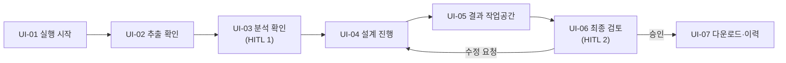

# 화면·사용자 흐름

> 상태: **초안** (화면 수·라이브러리는 회의 결정 전)

## 사용자 작업 흐름

## 화면 목록

| 화면 | 내용 | 사용자 행동 | 상태·실패 처리 |
|---|---|---|---|
| UI-01 실행 시작 | 파일 업로드, 팩 선택, 지원 형식·한도 안내 | 업로드·실행 | 파일 오류는 해당 항목에 표시, 중복 클릭 방지 |
| UI-02 추출 확인 | 원문 위치와 추출 블록 대조 | 수정·확인·보류 | 빈 페이지·깨진 표 표시, 추출 불확실성을 숨기지 않음 |
| UI-03 분석 확인 | 원문 ID·분류·분할·질문 | 유지·수정·분할 답변 | 필수 답변 누락·오래된 revision 안내 |
| UI-04 설계 진행 | 단계·병렬 가지·진행 상태 | 조회·취소 | SSE 재연결, 호출 실패·한도 초과 안내 |
| UI-05 결과 작업공간 | 기능·ERD·DDL·RTM·검토 탭 | 버전 선택·확대·지적 위치 이동 | 미완성 가지는 미완성으로 표시 |
| UI-06 최종 검토 | 변경 내용·지적·남은 오류 | 승인·수정 요청·보류 | 차단 오류가 있으면 승인 불가, 초안 내려받기는 표시 |
| UI-07 다운로드·이력 | 형식별 다운로드·승인 상태, 이전 실행 | 파일 선택·이전 실행 조회 | 생성 대기·파일 없음·접근 불가 안내 |

### MVP 축소안 (제안, ADR-0002)

| 화면 | 포함하는 기존 화면 |
|---|---|
| 업로드 | UI-01 |
| 확인·승인 | UI-02, UI-03, UI-06 |
| 결과 보기 | UI-04, UI-05, UI-07 |

## 표현 기준

- 상태를 색만으로 표현하지 않는다. 단계명·오류 원인·다음 행동을 함께 표시한다.
- ERD는 확대·이동과 원문(Mermaid) 다운로드를 제공한다. 렌더링은 브라우저의 `mermaid` JS 제안 (ADR-0005).
- 긴 설명은 펼쳐 볼 수 있게 하고, 키보드로 승인·보류를 고를 수 있게 한다.
- 원문과 수정본을 구분해 인용 근거를 확인할 수 있게 한다.
- 화면 구성 라이브러리: Ant Design 제안 (ADR-0005).

## 범위 밖

- 엔티티를 직접 편집하는 범용 모델 편집기. 설계 변경은 요구사항 수정·검토 피드백으로 재실행한다.
- 필요하면 모델 직접 수정은 별도 변경 요청으로 등록한다.

## 수용 시나리오

1. UI-01에서 설비관리 PDF와 `maintenance` 팩을 고른다.
2. UI-02에서 잘못 끊긴 표 문장을 고치고 원문 위치를 확인한다.
3. UI-03에서 설비의 상위 관계 조건을 보완한다.
4. UI-04에서 생성·검토 진행을 보고, UI-05에서 관계와 관련 REQ를 확인한다.
5. UI-06에서 지적을 보고 수정 요청한다. 새 revision이 끝나면 승인한다.
6. UI-07에서 기능 명세 PDF·ERD·SQL·RTM Excel을 내려받는다.

입력 위치 → 수정된 요구 → 설계 → 지적 → 다운로드가 같은 revision으로 이어지는지 확인한다. 새로고침·SSE 재연결 후 현재 상태를 복구하고 중복 재개를 막는다 (TC-F19).
